# Formula 1 Podium Prediction Companion

## Milestone 1 analytical report

**Student:** Mariam Aiman Adly Wazzef  
**Student ID:** 70-17793

**Run date:** 16 October 2026  
**Data:** [Formula 1 World Championship dataset on Kaggle](https://www.kaggle.com/datasets/rohanrao/formula-1-world-championship-1950-2020)  
**Coverage in the downloaded release:** 1950-2024, 75 seasons, 14 Ergast-style tables

## Executive summary

This project audits historical Formula 1 data, constructs a leakage-aware driver-race modeling table, answers three data-engineering questions, compares three model families, and includes a reusable pre-race inference function. The final table has 26,668 unique `(raceId, driverId)` observations. The split is chronological: train through 2019 (24,529 rows), validation in 2020-2021 (780 rows), and test in 2022-2024 (1,359 rows).

Validation PR-AUC selects the Shallow Neural Network (0.734; validation ROC-AUC 0.924; F1 0.700) with a frozen threshold of 0.456. On the untouched test window it scores PR-AUC 0.666, ROC-AUC 0.923, and F1 0.644. Random Forest test PR-AUC is 0.676; the model is still selected by validation only. This illustrates uncertainty in rankings across a short time split.

## 1. Problem definition and prediction cutoff

The target is a podium finish: `positionOrder <= 3`. One row represents one driver in one race. Prediction occurs after qualifying and final grid determination, before the race starts. Post-race results, points, status, laps, times, fastest-lap fields, pit stops, and current-race standings are excluded from predictors. Outcomes are used only to construct labels and answer historical descriptive questions.

## 2. Data and cleaning

The downloaded Kaggle archive includes circuits, constructors, constructor results and standings, drivers, driver standings, races, results, qualifying, lap times, pit stops, sprint results, seasons, and status. The data include 1,125 races and 26,759 raw results. Cleaning resolves 91 duplicate race-driver keys using the deterministic policy recorded in `tables/cleaning_log.csv`, yielding 26,668 unique entrant rows. Key and foreign-key audit results are in `tables/key_audit.csv` and `tables/foreign_key_audit.csv`.

Missing data are retained and treated according to feature type. Grid position 0/unknown is flagged separately. Qualifying and lap-time duration strings are parsed into numeric seconds, with source strings retained; post-race lap times are not model predictors. Raw-versus-cleaned row counts and pre-cleaning missingness/duplicate plots are saved alongside cleaned EDA. The feature dictionary is in `tables/feature_dictionary.csv`; full table inventory and cleaning evidence are under `tables/`.

## 3. Exploratory analysis

Coverage, entrant counts, qualifying availability, grid distribution, and podium prevalence vary by season. Qualifying records are much more complete in modern years, which limits direct comparisons across eras. Podiums are a minority class at entrant grain, so PR-AUC is the primary model-selection metric.

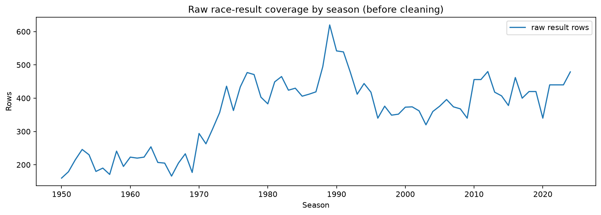

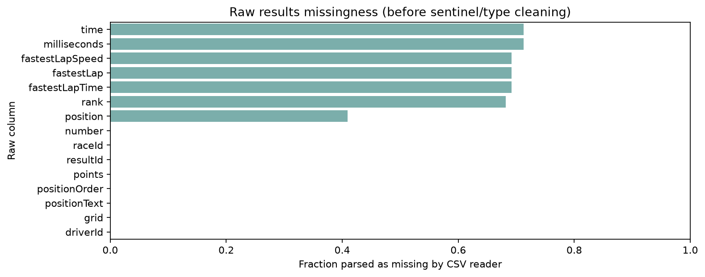

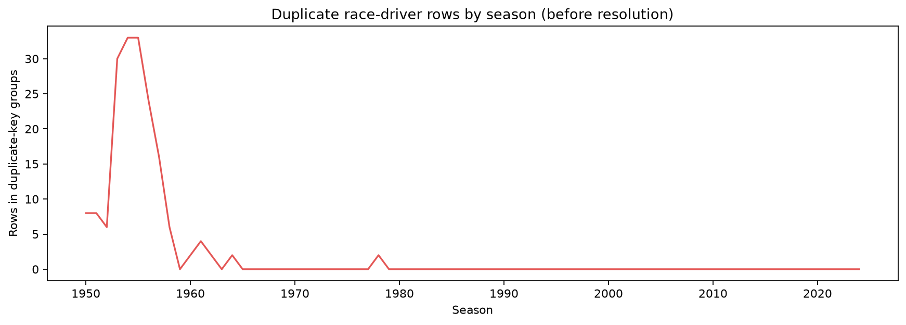

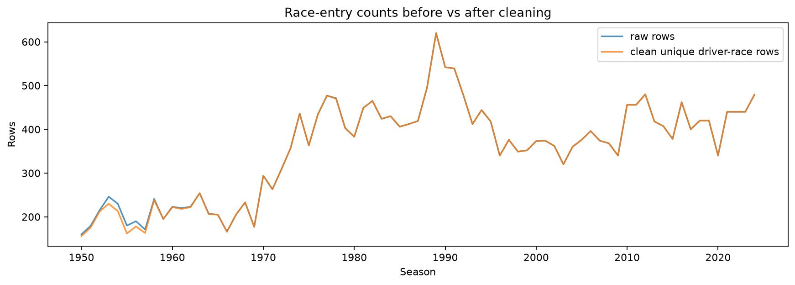

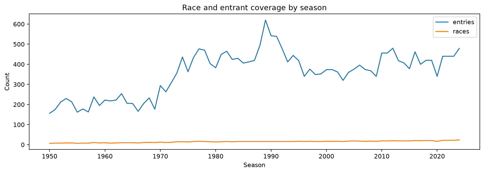

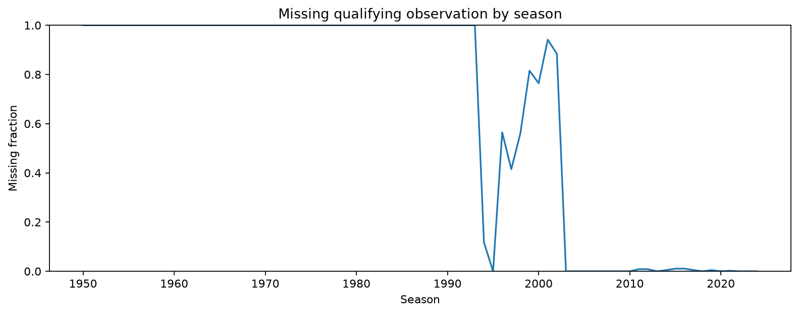

## 4. Required data-engineering questions

### 4.1 Front-row conversion by circuit and era

Front row means actual **starting-grid** positions 1 or 2, not qualifying ranks. Penalties and pit-lane starts can make qualifying and final grid differ. The audit found 2,509 differing values among 10,494 entries with both values; see `tables/q1_grid_vs_qualifying_audit.csv`. Circuit-period rankings require at least 10 front-row entries. From 2014-2021, Circuit of the Americas leads eligible circuits at 13 podiums from 14 entries (92.86%); Barcelona-Catalunya and Yas Marina each record 14/16 (87.50%). Before 2014, Magny-Cours leads at 29/36 (80.56%). No circuit-period in 2022-2024 reaches the threshold, so there is no ranked recent-period comparison. The findings are descriptive and do not estimate circuit effects.
### 4.2 Home-country podium rates at comparable grid positions

Driver nationalities and circuit countries are normalized and compared within common grid-position bins. The primary estimate retains all championship races. The Indianapolis 500 was a distinct oval and entry context; therefore, a sensitivity excludes its 1950-1960 championship events. With all races, the standardized podium rates are 12.44% for home and 12.77% for away entries (home minus away: -0.32 percentage points). Excluding Indianapolis, the rates are 12.61% and 12.81% (difference: -0.20 percentage points). Both are descriptive, small differences; neither controls for all driver, constructor, circuit, and era effects. Country-name mismatches are listed in `tables/q2_unmatched_countries.csv`; the comparison is observational and not causal.
### 4.3 Constructor mechanical-retirement rates

Mechanical retirements are identified through a documented keyword mapping of status strings, divided by constructor starts. Rankings require at least 50 starts per constructor-period. In 2014-2021, Toro Rosso leads eligible constructors (35/242, 14.46%), followed by Lotus F1 (9/76, 11.84%) and Renault (23/200, 11.50%). In 2022-2024, Alpine leads eligible constructors (13/136, 9.56%). The status mapping is imperfect, so these are rates under the stated text rules rather than verified engineering failure rates.

## 5. Features, leakage prevention, and split

Predictors include grid and qualifying information, race and season context, driver/constructor nationality, home-race status, field size, and historical driver/constructor performance. Indianapolis 500 rows are retained for championship completeness; the report includes a sensitivity for their effect on the home-race comparison. Historical form and standings are shifted so only prior events contribute. An allowlist and forbidden-feature checks prevent current-race outcomes from entering the feature set.

Train-only preprocessing imputes numeric/categorical values, creates missingness indicators, scales numeric features where used, and one-hot encodes categorical features with unknown-category support. The chronological partitions contain 24,529 training rows (1950-2019), 780 validation rows (2020-2021), and 1,359 test rows (2022-2024). No validation or test records are used to fit preprocessing.

## 6. Models and results

Logistic Regression and Random Forest are statistical baselines. The shallow neural network is an `MLPClassifier` with hidden layers of 64 and 32 ReLU units. TensorFlow was unavailable in the verified local environment, so the scikit-learn MLP fallback was used. The model was trained one epoch at a time, monitored on external validation log loss, stopped after 12 non-improving epochs, and restored the best validation-loss weights (best epoch 5). All use the same rows and feature columns. Each threshold maximizes validation F1; validation PR-AUC is the primary metric because podiums are the minority class, and F1 is the secondary thresholded metric. The selected threshold is frozen before test evaluation.

| Model | Split | PR-AUC | ROC-AUC | F1 | Precision | Recall |
|---|---|---:|---:|---:|---:|---:|
| Logistic Regression | Train | 0.573 | 0.918 | 0.567 | 0.563 | 0.572 |
| Logistic Regression | Validation | 0.680 | 0.923 | 0.701 | 0.711 | 0.692 |
| Logistic Regression | Test | 0.665 | 0.925 | 0.647 | 0.574 | 0.740 |
| Random Forest | Train | 0.630 | 0.920 | 0.585 | 0.589 | 0.580 |
| Random Forest | Validation | 0.697 | 0.918 | 0.704 | 0.717 | 0.692 |
| Random Forest | Test | 0.676 | 0.926 | 0.615 | 0.608 | 0.623 |
| Shallow Neural Network | Train | 0.618 | 0.925 | 0.560 | 0.629 | 0.505 |
| Shallow Neural Network | Validation | 0.734 | 0.924 | 0.700 | 0.683 | 0.718 |
| Shallow Neural Network | Test | 0.666 | 0.923 | 0.644 | 0.544 | 0.789 |

The model metrics and frozen thresholds by split are in `tables/model_evaluation.csv`. The neural network wins validation PR-AUC but has lower test PR-AUC than Random Forest. This temporal variation should be reported rather than using test performance to revise model selection.

## 7. Ablation and preprocessing experiments

Feature-group ablations retrain the validation-selected model family without one group at a time. Removing the grid/current-event pre-race group causes the largest validation PR-AUC drop (-0.068); removing qualifying features causes a smaller drop (-0.009). Removing historical driver form slightly improves validation PR-AUC (+0.006) in this split, which may reflect noise or feature redundancy and does not show historical form is generally unhelpful. Results and deltas are in `tables/ablation_results.csv`.

A separate Logistic Regression preprocessing experiment compares imputation plus missingness indicators plus scaling (validation PR-AUC 0.680) with imputation but no indicators or scaling (0.733). This changes two preprocessing choices together, so it cannot isolate which change accounts for the difference. The no-scaling experiment also emitted a convergence warning at 1,500 iterations; treat the result as tentative rather than proof of an optimal recipe.

## 8. Explainability

Validation permutation importance ranks grid highest by average-precision decrease. Global SHAP and a local SHAP waterfall are also saved. The local example is the held-out test row with the largest absolute probability-label error; the notebook reports its actual label, probability, threshold, and predicted class. It is an illustrative difficult case, not representative performance.

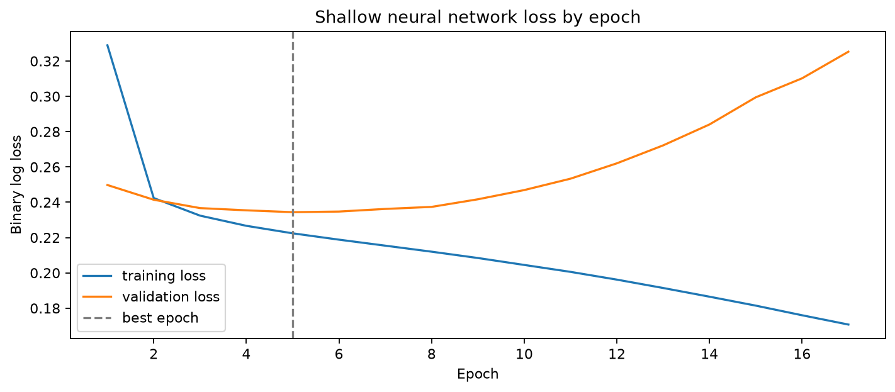

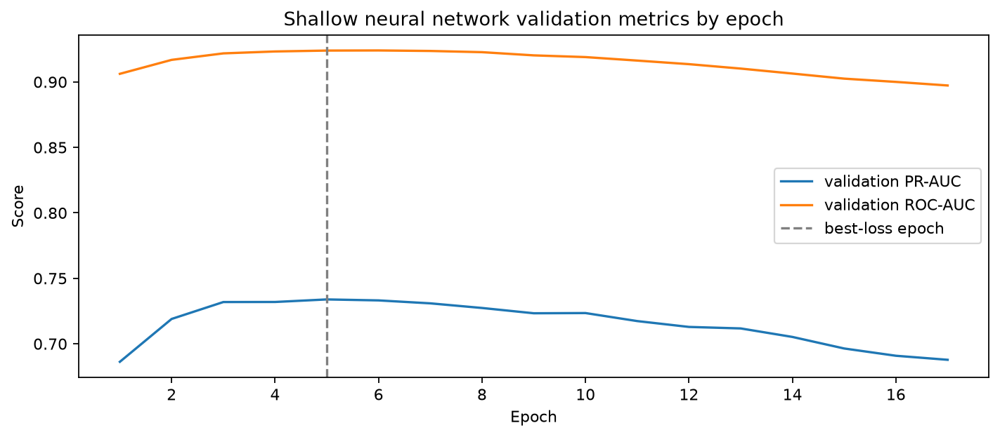

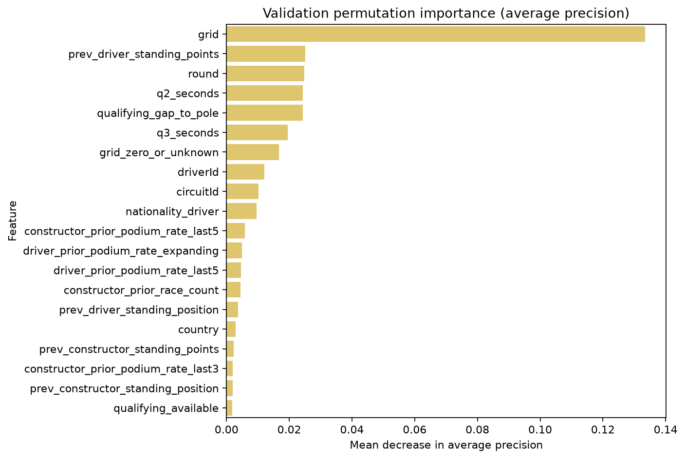

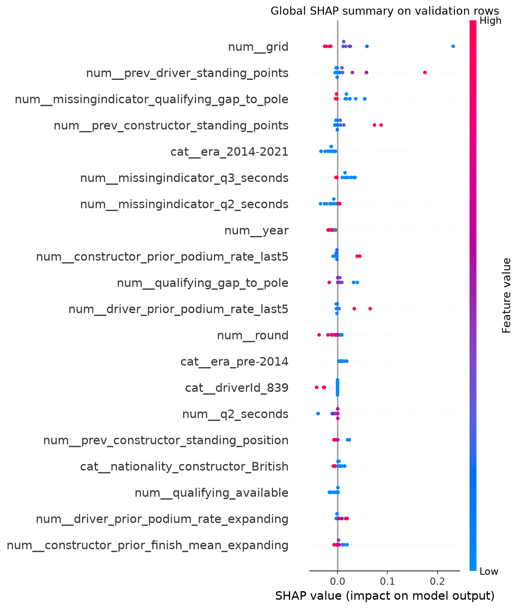

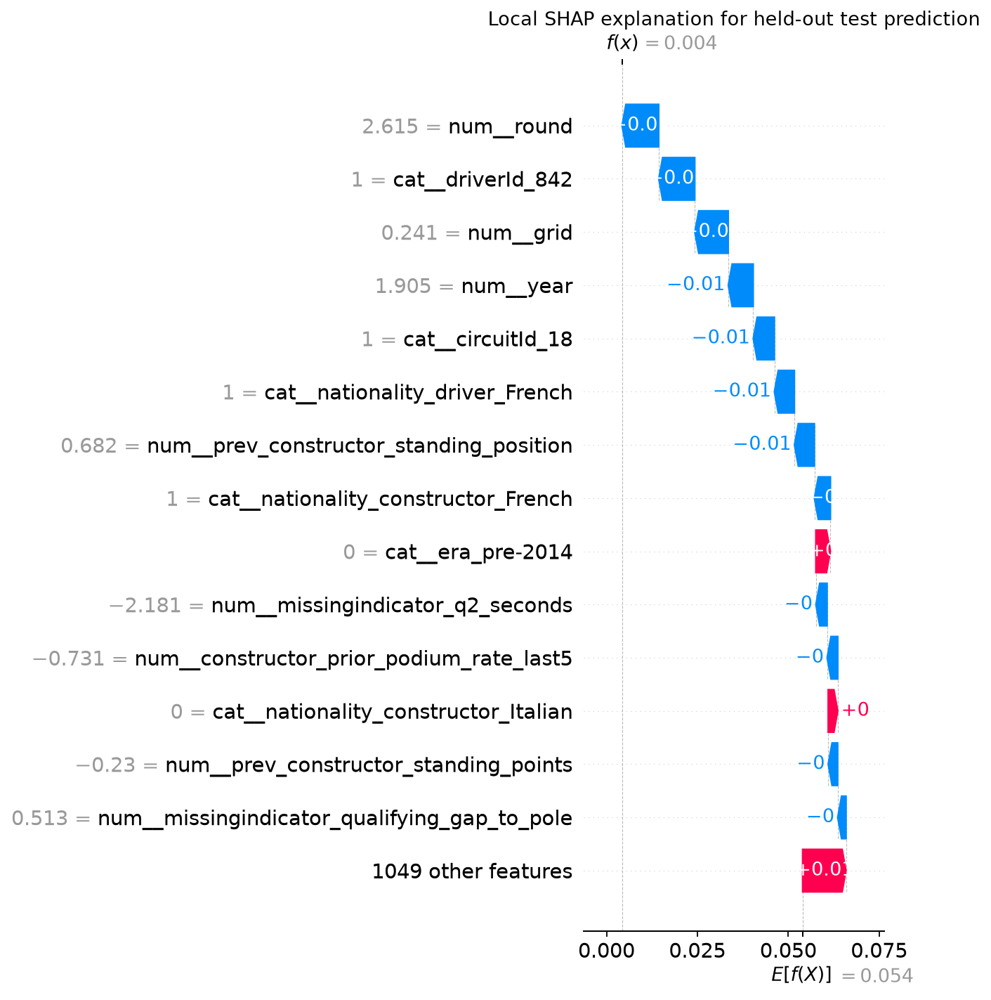

Permutation and SHAP values describe how the fitted model uses associations in this dataset; they do not show that a feature causes a podium finish.

## 9. Inference demonstration

`predict_podium_probability(record)` requires the grid field, accepts missing optional predictors and returns an imputation warning, supports unseen categories, and rejects recognized post-race fields. The executed notebook contains outputs for a complete record and a partially missing record with an unseen category.

## 10. Limitations and conclusion

The validation window spans two seasons and the test window three. Rules, cars, calendars, field strength, and qualifying coverage change across eras. Indianapolis 500 events (1950-1960) are retained for completeness but have a different oval/entry context; a Q2 exclusion sensitivity is reported. The number of podium labels in each holdout is modest. Country normalization and status-text mapping are imperfect, and identity effects do not generalize reliably to unseen drivers or constructors. Calibration intervals are not included. This is a reproducible historical baseline, not a race-weekend forecasting product or causal study.

## Data citation

Rao, Rohan. [Formula 1 World Championship (1950-2020), Kaggle dataset](https://www.kaggle.com/datasets/rohanrao/formula-1-world-championship-1950-2020). The downloaded archive used for this run includes seasons through 2024. Analysis run: 16 October 2026.

